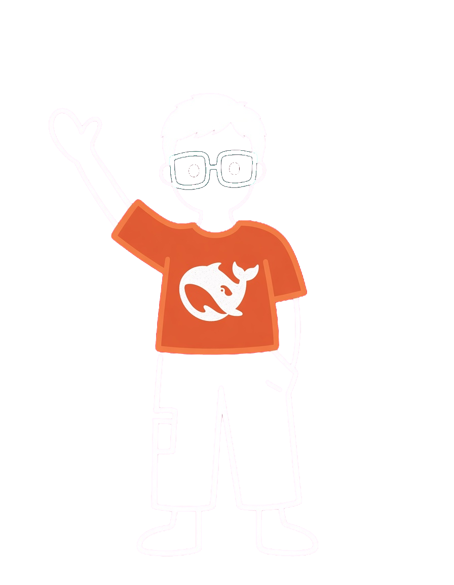
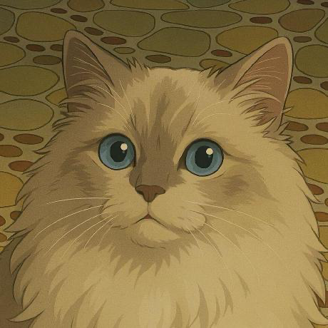

<HoSignature />

---
layout: intro
glow: left
class: pl-25
---

<div v-click>

# Elone Hoo

</div>


<div class="text-xl leading-10 op80">

<div v-click>

{Vue} {Vite} {Vitest} 团队成员

</div>
<div v-click class="mt-6">

{Nora} {Destyler Labs} 作者

</div>
<div v-click class="mt-6">Unstyled Las 维护者</div>

</div>

<div v-click mt-10 flex="~ gap-1 items-center">
  <div i-ri-user-3-line op50 text-xl />
  <a href="https://elonehoo.me" target="_blank" class="border-none! font-300">elonehoo.me</a>
  <div i-ri-github-line op50 text-xl ml4 />
  <a href="https://github.com/elonehoo" target="_blank" class="border-none! font-300">elonehoo</a>
</div>




<!--
大家好，在开始之前，先简单介绍一下我自己。

[click] 我是 Elone Hoo。

[click] 我是 Vue、Vite 和 Vitest 团队的成员，

[click] 也是 Nora 和 Destyler Labs 的作者，

[click] 同时在维护 Unstyled Las。

[click] 这是我的网站和 GitHub，今天的幻灯片之后也会放在网站上。

[click] 这是我，

[click] 跟大家打个招呼。
-->

---
layout: cover
class: pl-20 yak-title
glow: left
---

<div
  flex="~ gap-3 col" mt--5
  origin-bottom-left transition duration-500
  :class="$clicks < 2 ? 'scale-150 translate-y-10' : ''"
>
  
  <div text-5xl font-700 leading-tight>Yak Shaving</div>
</div>

<div v-click="2" forward:delay-300 text-4xl mt-2>「薅牛毛」</div>

<div abs-br mx-10 my-11 text-right v-click="2">
  <div op75>2026.11.18</div>
</div>

<!--
今天我想和大家聊的题目，叫做 Yak Shaving。

[click]

[click] 我把它翻译成「薅牛毛」。

今天真正要聊的，是怎么写好 Agent.md。不过在聊它之前，我想先花几分钟把「薅牛毛」这个词讲清楚，因为它是今天整场分享的线索。
-->

---
layout: fact
---

# 什么是「薅牛毛」？{.important-text-3em}

Yak Shaving

<!--
那么，什么是「薅牛毛」，也就是 Yak Shaving？
-->

---
class: flex justify-center items-center gap-20 px40 text-xl
glow: bottom
---

<div transition duration-500 :class="$clicks === 0 ? 'translate-x-26 translate-y-20' : ''">

# Yak{.important-text-3em}

<div v-click forward:delay-600>

<div font-serif op75 text-2xl mb2>/jak/</div>

<div op50 italic text-base>a type of cattle with <br>long hair and long horns</div>

牦牛；犛牛

</div>
</div>

<div transition duration-500 :class="$clicks === 0 ? 'translate-x--10 translate-y-20' : ''">

# Shaving{.important-text-3em}

<div v-click>

<div font-serif op75 text-2xl mb2>/ˈʃeɪ.vɪŋ/</div>

<div op50 italic text-base>to remove hair from the body<br><span op0>.</span></div>

剃去毛发；刮胡子

</div>
</div>

<!--
我们先把这个词拆开来看。

[click] 第一个词 Yak，读作 /jak/，是一种毛很长、角也很长的牛，也就是牦牛。

[click] 第二个词 Shaving，就是剃毛、刮胡子的意思。

合在一起，字面意思就是「给牦牛剃毛」。你可能会问，给牦牛剃毛和写代码有什么关系？我们来看一个例子。
-->

---
glow: left
---

# 薅牛毛的例子

<div mt-4 />

<div grid="~ cols-[4fr_2fr] gap-2">

<v-clicks>

- 你让模型<span text-red>改一个按钮的颜色</span>
- 它觉得颜色不该写在组件里，<br>决定先做<span text-orange>一整套设计系统</span>；

- 做着做着，它发现没有令牌，<br>决定再写一套<span text-green>设计令牌</span>；
- 然后还需要：<br><span text-violet>组件库</span>，<span text-yellow>图标</span>，<span text-blue>暗色模式</span>，<span text-teal>构建脚本</span> 等等；
- 一个回合之后...
- 你发现它不知为什么正在给 <span text-fuchsia>Linux</span> 提交 PR...
- 等一下，你的按钮呢？

</v-clicks>

<div v-click>

<YakExample scale-130 />

</div>

</div>

<!--
假设今天你打开编辑器，对模型说了一句很简单的话。

[click] 帮我改一下这个按钮的颜色。

[click] 模型看了一眼，觉得颜色不应该直接写在组件里，这样不够规范，于是它决定先搭一整套设计系统。

[click] 做着做着，它发现项目里没有设计令牌，那就再写一套设计令牌吧。

[click] 然后，既然都有设计系统了，组件库、图标、暗色模式、构建脚本，好像也都应该补上。

[click] 一个回合过去了。

[click] 你回来一看，它不知道为什么，正在给 Linux 提交 PR。

[click] 等一下，你的按钮呢？

[click] 右边就是这一整条链。每一步单独拿出来看都很合理，甚至可以说都是好事。但连在一起，它离你最初那个按钮越来越远。
-->

---
class: flex flex-col gap-4 items-center justify-center
---

<div text-center flex="~ col gap-4" text-2xl mt--4>
  <div text-3xl font-hand op50>Yak Shaving</div>
  <div text-6xl mb8>「薅牛毛」</div>
  <div v-click>指在解决问题的过程引发的一系列任务链，</div>
  <div v-after><span v-mark.orange="2">导致最终偏离了原本的目标</span></div>
</div>

<div v-click="3" op75>*通常带有负面的含义</div>

<div text-center mt-8 v-click="4">
  <div op50>或称</div>
  <div flex="~ gap-2 items-center" font-hand><div i-lucide-rabbit /> Down to the Rabbit Hole</div>
  <div op75 mt2>「一头扎进兔子洞里」</div>
</div>

<!--
这种现象，就叫做「薅牛毛」。

[click] 它指的是在解决问题的过程中，引发了一系列的任务链，

[click] 导致最终偏离了原本的目标。

[click] 这个词通常带有负面的含义，用来提醒大家保持专注，不要陷进无止尽的细节里。

[click] 它还有一个类似的说法，叫做 Down to the Rabbit Hole，「一头扎进兔子洞里」。

人会薅牛毛，模型也会。而且，模型比我们更擅长。
-->

---
glowSeed: 10
---

# 为什么要写 Agent.md

<p v-click>模型天生就是「薅牛毛」高手。Agent.md 不是让它少做事，而是把它圈回目标里</p>

<div flex="~ col gap-7" py10>

<div v-click><div flex="~ inline" text-blue mr2 px2 rounded bg-blue:10>能力</div>模型什么都做得了，每个「合理的下一步」它都会做</div>

<div v-click><div flex="~ inline" text-rose mr2 px2 rounded bg-rose:10>约定</div>仓库里已有的做法，不写出来，它就自己发明一套</div>
<div v-click><div flex="~ inline" text-yellow mr2 px2 rounded bg-yellow:10>边界</div>这次要做什么、做到哪一步就停</div>
<div v-click><div flex="~ inline" text-green mr2 px2 rounded bg-green:10>结果</div>三者重叠的地方，才是我们真正想要的改动</div>

</div>

<div absolute left-150 top-20>
  <div
    absolute w-50 h-50 left-0 top-28 border="~ blue rounded-full"
    bg-blue:20 text-xl text-blue flex="~ items-center justify-center"
    v-click="2"
  >
    <div :class="{pr15: $clicks>2, pt8: $clicks>3}" transition-all duration-400>模型能做的</div>
  </div>
  <div
    absolute w-50 h-50 left-34 top-28 border="~ rose rounded-full"
    bg-rose:20 text-xl text-rose flex="~ items-center justify-center"
    v-click="3"
  >
    <div pl15 :class="{pt8: $clicks>3}" transition-all duration-400>仓库约定的</div>
  </div>
  <div
    absolute w-50 h-50 left-17 top-0 border="~ amber rounded-full"
    bg-amber:20 text-xl text-amber flex="~ items-center justify-center"
    v-click="4"
  >
    <div pb10>这次要做的</div>
  </div>
  <Arrow v-click="5" x1="160" y1="340" x2="170" y2="175" color="green" />
  <div
    v-click="5"
    absolute top-85 left-5 ws-nowrap
    border="~ green rounded-full" px3 py1
    bg-green:20 text-xl text-green
  >不多不少，改完就停</div>
</div>

<!--
这就是为什么我们需要 Agent.md。

[click] 模型天生就是「薅牛毛」高手。它不会累，也不会嫌麻烦，每多做一步对它来说成本都很低。所以 Agent.md 要做的，不是限制它的能力、让它少做事，而是把它圈回我们的目标里。

[click] 蓝色是模型的能力。今天的模型几乎什么都做得了，所以每一个看起来合理的下一步，它都会做下去。

[click] 红色是仓库的约定。每个仓库都有自己已有的做法：用什么包管理器，颜色放在哪里，测试怎么跑。这些如果不写出来，它就只能猜；猜不到，就自己发明一套。刚才那套设计系统，就是这么来的。

[click] 黄色是这一次的边界：这次到底要做什么，做到哪一步就该停。

[click] 只有三者重叠的地方，才是我们真正想要的那一次改动：不多不少，改完就停。

模型的能力是现成的，我们不需要教它。而仓库的约定和这一次的边界，它自己没办法知道。这两样，就是 Agent.md 要写下来的东西。
-->

---

# 模型的「牛毛」

<div grid="~ cols-2 gap-8" pt6>

<div v-click="1" bg-orange:10 border="~ orange/50 rounded-lg">
  <div flex="~ items-center gap-2" bg-orange:10 px4 py2 rounded text-orange><div i-ph-paint-brush-duotone text-xl /> 改按钮颜色</div>

  <div ml2 p2 text-orange1>
  <v-clicks :at="2">

  - 先做了一整套设计系统
  - <span op50>Agent.md：</span>用仓库里已有的颜色，改完就停

  </v-clicks>
  </div>
</div>

<div v-click="4" bg-blue:10 border="~ blue/50 rounded-lg">
  <div flex="~ items-center gap-2" bg-blue:10 px4 py2 rounded text-blue><div i-ph-bug-duotone text-xl /> 修一个 bug</div>

  <div ml2 p2 text-blue1>
  <v-clicks :at="5">

  - 顺手重构了整个模块
  - <span op50>Agent.md：</span>只改和这个问题有关的文件

  </v-clicks>
  </div>
</div>

<div v-click="7" bg-green:10 border="~ green/50 rounded-lg">
  <div flex="~ items-center gap-2" bg-green:10 px4 py2 rounded text-green><div i-ph-package-duotone text-xl /> 加一个功能</div>

  <div ml2 p2 text-green1>
  <v-clicks :at="8">

  - 装了三个新依赖，还换了包管理器
  - <span op50>Agent.md：</span>用 pnpm，不新增依赖

  </v-clicks>
  </div>
</div>

<div v-click="10" bg-rose:10 border="~ rose/50 rounded-lg">
  <div flex="~ items-center gap-2" bg-rose:10 px4 py2 rounded text-rose><div i-ph-flask-duotone text-xl /> 让测试通过</div>

  <div ml2 p2 text-rose1>
  <v-clicks :at="11">

  - 把失败的测试改掉了
  - <span op50>Agent.md：</span>测试失败先告诉我，不要改测试

  </v-clicks>
  </div>
</div>

</div>

<!--
光有一个按钮的例子可能还不够，我们再看几个更日常的场景。

[click] 第一个，还是改按钮颜色。

[click] 它先做了一整套设计系统。

[click] 其实在 Agent.md 里只需要一句话：用仓库里已有的颜色，改完就停。

[click] 第二个，修一个 bug。

[click] 它觉得这个模块写得不好，顺手把整个模块重构了。bug 可能修好了，但你的 diff 变成了几千行。

[click] 一句话：只改和这个问题有关的文件。

[click] 第三个，加一个功能。

[click] 它装了三个新依赖，还顺便把包管理器换了。

[click] 一句话：用 pnpm，不新增依赖。

[click] 第四个，让测试通过。

[click] 它确实让测试通过了，方法是把失败的测试改掉。

[click] 一句话：测试失败先告诉我，不要改测试。

大家会发现，每一头「牛毛」，对应的其实都只是一句话。
-->

---
glow: right
---

# Agent.md 的编写流程

<div flex="~ col gap-1" py5>
  <div v-click flex="~ items-center gap-2"><div text-2xl i-ph-play-duotone text-yellow /> 先让模型干一次活，看它在哪里跑偏</div>
  <div v-click i-ph-arrow-down op25 ml-1 text-sm />
  <div v-after flex="~ items-center gap-2"><div text-2xl i-ph-magnifying-glass-duotone text-blue /> 找仓库里已有的做法：README、配置、已有代码</div>
  <div v-click absolute left-122 top-40 bg-blue:10 border="~ blue/50 rounded-lg" p2 py1>
    <div text-sm text-blue2>
      能指过去的，就别重写一遍
    </div>
  </div>
  <div v-click i-ph-arrow-down op25 ml-1 text-sm />
  <div flex="~ items-center gap-2">
    <div text-2xl i-ph-crosshair-duotone text-green v-after />
    <span v-after>写下目标；写下做到哪一步就停；把走过的弯路写成一句禁止；</span>
    <span v-click text-yellow font-bold flex="~ gap-1 items-center" ml--2>写完就停<div i-ph-arrow-square-out-duotone /></span>
  </div>
  <div v-click absolute left-176 top-52 bg-yellow:10 border="~ yellow/50 rounded-lg" p2 w-54>
    <div text-sm text-yellow2>
      别把 Agent.md 本身也写成一头牦牛。只写这次跑偏的那一句。
    </div>
  </div>
  <div v-click i-ph-arrow-down op25 ml-1 text-sm />
  <div v-after flex="~ items-center gap-2"><div text-2xl i-ph-arrow-clockwise-duotone text-teal /> 用同一个任务再跑一次，确认这一句起作用</div>
  <div v-click i-ph-arrow-down op25 ml-1 text-sm />
  <div v-after flex="~ items-center gap-2"><div text-2xl i-ph-git-commit-duotone text-rose /> 提交进仓库，和代码一起评审</div>
  <div v-click absolute left-84 top-77 bg-rose:10 border="~ rose/50 rounded-lg" p2 py1>
    <div text-sm text-rose2>
      提交信息里写清楚：它之前犯了什么错
    </div>
  </div>
  <div v-click i-ph-arrow-down op25 ml-1 text-sm />
  <div v-after flex="~ items-center gap-2"><div text-2xl i-ph-users-three-duotone text-violet /> 交给团队每天使用</div>
    <div v-click flex="~ items-center gap-2" pl-4 mt4><div i-ph-arrow-elbow-down-right op25 ml-1 text-sm /><div text-2xl i-ph-trash-duotone text-gray /> 没有变化：删掉这一句。短，它才记得住</div>
    <div v-click flex="~ items-center gap-2" pl-4 mt4><div i-ph-arrow-elbow-down-right op25 ml-1 text-sm /><div text-2xl i-ph-check-circle-duotone text-orange /> 跑偏消失了：留下来。整个团队都不用再踩这个坑</div>
</div>

<!--
那具体应该怎么写？我不建议一上来就写一份很长、很完整的规范。我更推荐的是这样一个流程。

[click] 第一步，先让模型干一次活，看它在哪里跑偏。跑偏的地方，就是需要写的地方。

[click] 第二步，去找仓库里已有的做法：README、配置文件、已有的代码。

[click] 这里有一个原则：能指过去的，就别在 Agent.md 里重写一遍。重写一遍，就多了一份需要同步的东西。

[click] 第三步，只写三样东西：这次的目标，做到哪一步就停，以及把刚才走过的弯路，写成一句禁止。

[click] 这一步的关键是「写完就停」。

[click] 我们在讲怎么避免薅牛毛，那就别把 Agent.md 本身也写成一头牦牛。你不需要一次把所有规则都写完，只写这次跑偏的那一句就够了。

[click] 第四步，用同一个任务再跑一次，确认这一句真的起作用。

[click] 起作用了，就把它提交进仓库，和代码一起评审。

[click] 提交信息里写清楚：它之前犯了什么错。这样以后无论是谁看到这一句，都知道它为什么会在这里。

[click] 最后，交给团队每天去使用。

[click] 如果用了一段时间发现没有变化，那就删掉这一句。Agent.md 每次开工都会被读一遍，越短，它越记得住。

[click] 如果跑偏真的消失了，就把它留下来。你踩过的坑，整个团队都不用再踩一次。

（停一下）
-->

---
layout: center
---

# 一个仓库，五种语言 {.important-text-5xl}

<!--
讲了这么多方法，我们来看一个更难的场景：一个仓库里同时有好几种语言，Agent.md 该怎么写？我用 Nora 来举例，它同时有 Rust、Swift、Go、Zig 和 TypeScript。
-->

---
glow: top
---

# 多语言仓库的 Agent.md

<div grid="~ cols-[5fr_2fr] gap-6" pt2>

```md {3-5|7-8|10-12|14-17|all}
# AGENTS.md

## 项目结构
cli/  macos/  packages/runtime/  packages/gateway/  …
共享的 runtime 不能依赖任何一个 UI。

## 子模块指南
- macos/AGENTS.md：macOS 应用自己的规则

## 常用命令
统一用根目录的 make：make build / make test / make check
只动一个模块：make runtime-test、make test-macos …

## 分语言规则
- Rust：大范围改动后，先跑 make agents-check
- Swift：不要 patch、vendor 或 fork 依赖
- TypeScript：用 pnpm 管理依赖
```

<div flex="~ col gap-6" pt4 text-lg>
  <div transition duration-300 :class="[0, 4].includes($clicks) ? '' : 'op20'"><div flex="~ inline" text-yellow mr2 px2 rounded bg-yellow:10>结构</div>先画地图，划清边界</div>
  <div transition duration-300 :class="[1, 4].includes($clicks) ? '' : 'op20'"><div flex="~ inline" text-violet mr2 px2 rounded bg-violet:10>分层</div>子目录各写各的</div>
  <div transition duration-300 :class="[2, 4].includes($clicks) ? '' : 'op20'"><div flex="~ inline" text-rose mr2 px2 rounded bg-rose:10>入口</div>一套命令管所有语言</div>
  <div transition duration-300 :class="[3, 4].includes($clicks) ? '' : 'op20'"><div flex="~ inline" text-blue mr2 px2 rounded bg-blue:10>分语言</div>每种语言只写它的坑</div>
  <div op50 text-sm mt4>以 Nora 为例<br>Rust · Swift · Go · Zig · TypeScript</div>
</div>

</div>

<!--
这是一份多语言仓库的 Agent.md 的骨架，内容取自 Nora，我精简并翻成了中文。多语言仓库最大的问题是：模型很容易把一种语言的习惯带到另一种语言里，或者把代码放错地方。所以它的写法有四个要点。

第一，先画地图。根目录的 Agent.md 先写项目结构：每个目录是什么语言、负责什么。然后划清边界，比如共享的 runtime 不能依赖任何一个 UI。模型知道了代码该放在哪里，才不会把东西写进错误的模块。

[click] 第二，分层。根目录只放全局的东西，每个子模块自己的规则，写在它自己目录下的 AGENTS.md 里，比如 macos/AGENTS.md。根目录只放一个链接。这样模型改 macOS 应用的时候，才会读到那些只和 macOS 有关的规则；改别的模块时，也不会被它们干扰。

[click] 第三，统一入口。五种语言就有五套工具链：pnpm、cargo、go、zig、Xcode。如果让模型自己挑，它每次都可能挑一个不同的。所以统一用根目录的 make：make build、make test、make check。只动一个模块的时候，也有对应的窄命令，不用每次都把整个仓库跑一遍。

[click] 第四，分语言写规则。每种语言只写它自己的坑：Rust 改完要跑 agents-check，Swift 不要去 patch 或 fork 依赖，TypeScript 用 pnpm。不要写一份通用的「代码规范」，它本来就会写代码。

[click] 合起来看，就是一份地图，加上几条只属于这个仓库的路。语言再多，写法也还是那几样：边界、约定、禁止和停。
-->

---
layout: center
glow: center
---

<h1 important-text-5xl><span transition duration-700 inline-block :class="$clicks === 0 ? 'translate-x-40' : ''">Agent.md</span> <span forward:delay-400 v-click>is about Stopping</span></h1>

<div text-2xl op50 v-click>写清楚，什么时候该停下来</div>

<!--
最后，如果只能用一句话来总结 Agent.md，

[click] 我会说，它是关于「停下来」的。

[click] 写清楚，什么时候该停下来。

回到今天的主题：薅牛毛的问题，从来不是做得太少，而是停不下来。模型的能力已经足够了，它缺的，只是知道什么时候该停。
-->

---
glow: bottom
---

# 对 Agent.md 的期待

<div grid="~ cols-3 gap-2" py4>
  <div v-click flex="~ col gap-1" p4 rounded bg-violet:15 text-violet1>
    <div text-2xl i-ph-compass-duotone text-violet mb2 />
    <div>它是地图，不是手册</div>
    <div text-xs op50>A Map, not a Manual</div>
  </div>

  <div v-click flex="~ col gap-1" p4 rounded bg-orange:15 text-orange1>
    <div text-2xl i-ph-scissors-duotone text-orange mb2 />
    <div>越短越好</div>
    <div text-xs op50>Shorter is Better</div>
  </div>

  <div v-click flex="~ col gap-1" p4 rounded bg-rose:15 text-rose1>
    <div text-2xl i-ph-footprints-duotone text-rose mb2 />
    <div>每一句都来自一次跑偏</div>
    <div text-xs op50>Every Line is a Lesson</div>
  </div>

  <div v-click flex="~ col gap-1" p4 rounded bg-green:15 text-green1>
    <div text-2xl i-ph-plant-duotone text-green mb2 />
    <div>它和仓库一起生长</div>
    <div text-xs op50>It Grows with the Repo</div>
  </div>

  <div v-click flex="~ col gap-1" p4 rounded bg-blue:15 text-blue1>
    <div text-2xl i-ph-user-focus-duotone text-blue mb2 />
    <div>你是第一个受益的人</div>
    <div text-xs op50>You are the First User</div>
  </div>
</div>

<div absolute bottom-10 v-click>
<div op75 mb1>文章推荐</div>

- [AGENTS.md](https://agents.md)<span op50 text-sm> - 给编程 Agent 的开放格式</span>
- [Claude Code: Best practices for agentic coding](https://www.anthropic.com/engineering/claude-code-best-practices)<span op50 text-sm> - Anthropic</span>

</div>

<!--
最后说几点我对 Agent.md 的期待。

[click] 第一，它是地图，不是手册。它告诉模型路在哪里，而不是教模型怎么走路。模型本来就会写代码。

[click] 第二，越短越好。每次开工它都会被读一遍，写得越长，每一句的分量就越轻。

[click] 第三，每一句都来自一次跑偏。没有跑偏过的地方，就不用写。

[click] 第四，它和仓库一起生长。仓库变了，它也要跟着改，过时的句子要及时删掉。

[click] 第五，你会是第一个受益的人。你不用再一遍又一遍地把同样的话说给模型听。

[click] 如果大家对这个话题有兴趣，推荐这两篇：一个是 AGENTS.md 这个开放格式本身，另一个是 Anthropic 关于 Claude Code 的最佳实践。
-->

---
layout: intro
class: pb-5
glowX: 50
glowY: 120
---

<div class="flex items-center justify-center gap-12 h-full">
  <div class="text-center">
    <h1 class="font-hand italic">Happy Shaving!</h1>
    <div class="op70">PPT 在 <a href="https://elonehoo.me/talks">https://elonehoo.me/talks</a></div>
  </div>
</div>

<!--
今天的分享就到这里。

祝大家都能写出一份好的 Agent.md，也祝大家 Happy Shaving：该薅的牛毛就去薅，不该薅的，记得停下来。

谢谢大家！幻灯片会放在我的网站 elonehoo.me/talks 上。
-->
